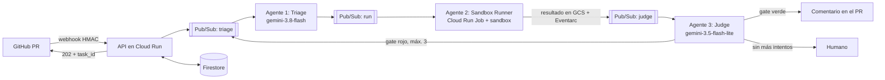

# CodeSentry Swarm

[English](README.md) · **Español**

Un enjambre de agentes que audita un Pull Request, prueba su hipótesis en un sandbox aislado y propone un fix tipado. Es la demo de la charla **De Endpoints a Enjambres de Agentes: Patrones de Arquitectura Backend en GCP para Sistemas Autónomos**.

La idea central: el caos probabilístico vive detrás de una cola, y las decisiones importantes las toma código determinista.



## Correr la demo (sin red ni cuenta de nube)

Necesitas Python 3.12 y [uv](https://docs.astral.sh/uv/).

```bash
uv sync
```

```bash
uv run codesentry demo
```

Escenarios, todos offline:

| Comando | Qué muestra |
| --- | --- |
| `uv run codesentry demo` | Hipótesis equivocada, test rojo, hipótesis corregida, exit 0 y reporte JSON |
| `uv run codesentry demo --scenario exhausted` | Tres intentos fallidos y escalada a un humano |
| `uv run codesentry demo --scenario budget` | El presupuesto de tokens corta la tarea |
| `uv run codesentry demo --scenario hostile` | Un fix que toca CI, otro que reescribe los tests y un test que intenta salir a la red |

**Qué es real y qué no en este modo:** pytest se ejecuta de verdad, con exit codes reales. Las respuestas del modelo vienen de `demo/replays/` y están **escritas a mano**, igual que sus conteos de tokens, así que el costo que se imprime es ilustrativo. Dilo en el escenario, o sustitúyelas por respuestas reales (ver abajo).

Con Docker, el código corre sin red, sin capacidades y con raíz de solo lectura:

```bash
docker build -f Dockerfile.sandbox -t codesentry-sandbox:local .
```

```bash
uv run codesentry demo --sandbox docker --scenario hostile
```

`--sandbox subprocess`, el valor por defecto, limpia el entorno y pone timeouts, pero **no es una frontera de seguridad**: no aísla la red, y el test de `hostile` de verdad intenta llegar a `169.254.169.254`. Úsalo solo con estos fixtures. Para ejecutar código ajeno usa Docker.

## Demostrarlo en la charla

1. Antes de salir, corre `./scripts/verify.sh` y graba `uv run codesentry demo` por si la laptop falla.
2. Plan A, con Gemini real (necesita red y `gcloud auth application-default login`):

```bash
uv sync --extra gcp
```

```bash
CODESENTRY_PROJECT_ID=tu-proyecto uv run codesentry demo --llm gemini --sandbox docker --record demo/recorded
```

3. Plan B, sin red: `uv run codesentry demo --sandbox docker`. Si grabaste en el paso 2, copia `demo/recorded/discount/*.json` sobre `demo/replays/discount/` y el respaldo tendrá respuestas y tokens reales.
4. `--pace 1.5` da más tiempo para narrar cada evento.

Un modelo real puede acertar a la primera, y entonces no verás el rojo intermedio. Graba hasta tener la corrida que quieres contar, o usa el replay.

## El flujo con API y SSE

```bash
CODESENTRY_WEBHOOK_SECRET=demo uv run codesentry serve
```

```bash
CODESENTRY_WEBHOOK_SECRET=demo uv run codesentry webhook
```

La respuesta es `202` con `task_id` y `events_url`. Sigue el progreso con:

```bash
curl -N http://127.0.0.1:8080/tasks/TASK_ID/events
```

## Guardrails

Todos viven en código y tienen tests:

- **Gate determinista:** el test debe fallar antes del fix y toda la suite pasar después. El modelo no puede aprobar un run rojo.
- **Política de edición:** solo archivos fuente que ya existen. Nada de tests, CI ni dotfiles, para que nadie gane reescribiendo al juez.
- **Máximo 3 iteraciones**, luego un humano.
- **Presupuesto de tokens por tarea**, circuit breaker, timeout duro por llamada y fallback al modelo ligero.
- **Idempotencia:** el `task_id` sale del commit y cada etapa se reclama una sola vez, así que los webhooks y mensajes duplicados no repiten trabajo.
- **Reintentos con backoff y dead letter**, en Pub/Sub y en el bus local.
- **Sin escritura automática:** comenta en el PR, nunca hace push. El merge es humano.

## Demo en vivo sobre lo desplegado

```bash
./scripts/open-demo-pr.sh
```

Abre un PR nuevo en [codesentry-demo-shop](https://github.com/listerineh/codesentry-demo-shop) y el enjambre comenta en unos 2 o 3 minutos. `./scripts/demo-status.sh PROYECTO` muestra comentarios, ejecuciones y errores, y `./scripts/open-escape-pr.sh` prueba el sandbox desde dentro. Para publicar un commit nuevo usa `./scripts/redeploy.sh PROYECTO`.

## Limitaciones

- Verde es evidencia, no prueba. Un test malicioso puede fingir ciertos resultados, por eso `gate()` exige tests ejecutados y una persona revisa.
- Solo analiza Python.
- El estado de una tarea cuyo job muere sin escribir resultado se queda en `running`. Falta un barredor con Cloud Scheduler.
- Si guardar el estado falla justo después de comentar, el reintento puede duplicar el comentario.

## Google Cloud

Nada aquí crea recursos solo. Para desplegar:

```bash
terraform -chdir=infra init -backend-config="bucket=TU_BUCKET_DE_ESTADO"
```

```bash
terraform -chdir=infra plan -out=tfplan -var project_id=TU_PROYECTO -var api_image=TU_IMAGEN_API -var sandbox_image=TU_IMAGEN_SANDBOX
```

Revisa el plan con `tflint` y `trivy` antes de aplicarlo. Luego:

1. Crea las versiones de los secretos `codesentry-webhook-secret`, `codesentry-api-token` y `codesentry-github-token`.
2. Activa los sandboxes en el job con `gcloud auth print-access-token | scripts/enable-sandbox.py TU_PROYECTO`.
3. Pega la salida `webhook_url` en los webhooks del repositorio de prueba.

Las fuentes de cada decisión de plataforma están en [docs/verified-facts.md](docs/verified-facts.md).

## Desarrollo

```bash
uv sync --extra gcp
```

```bash
./scripts/verify.sh
```
