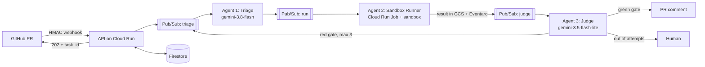

# CodeSentry Swarm

**English** · [Español](README.es.md)

A multi-agent pipeline that audits a pull request, tests its hypothesis in an isolated sandbox and proposes a typed fix. It is the demo for the talk **From Endpoints to Agent Swarms: Backend Architecture Patterns on GCP for Autonomous Systems**.

The core idea: probabilistic chaos lives behind a queue, and the decisions that matter are made by deterministic code.



## Quick start (no network, no cloud account)

You need Python 3.12 and [uv](https://docs.astral.sh/uv/).

```bash
uv sync
```

```bash
uv run codesentry demo
```

All scenarios run offline:

| Command | What it shows |
| --- | --- |
| `uv run codesentry demo` | A wrong hypothesis, a red test, a corrected hypothesis, exit 0 and a JSON report |
| `uv run codesentry demo --scenario exhausted` | Three failed attempts, then a human |
| `uv run codesentry demo --scenario budget` | The token budget stops the task |
| `uv run codesentry demo --scenario hostile` | A fix that touches CI, one that rewrites the tests, and a test that tries to reach the network |

**What is real in this mode:** pytest runs for real, with real exit codes. The model answers come from `demo/replays/` and are **hand-written**, as are their token counts, so the printed cost is illustrative. Say so if you present it, or replace them with recorded answers.

With Docker, code runs with no network, no capabilities and a read-only root:

```bash
docker build -f Dockerfile.sandbox -t codesentry-sandbox:local .
```

```bash
uv run codesentry demo --sandbox docker --scenario hostile
```

The default `--sandbox subprocess` scrubs the environment and enforces timeouts, but it is **not a security boundary**: it has no network isolation, and the `hostile` test really does try to reach `169.254.169.254`. Use it with these fixtures only. Use Docker for code you don't trust.

## How a run works

1. The webhook verifies the HMAC signature, stores a task and answers `202` with a `task_id`. The ID comes from the commit, so a redelivered webhook lands on the same task.
2. **Triage** reads the diff and an AST outline, then returns a hypothesis, a pytest module and full-file edits.
3. **Sandbox Runner** runs the new test against the pull request (it must fail), then the whole suite with the fix (it must pass).
4. **Judge** receives the exit codes and writes the verdict. It can reject a green run, but it can't approve a red one.
5. A passing run comments the fix and a typed JSON report on the pull request. A failing run returns to Triage with feedback, up to 3 iterations, and then asks for a human.

## Guardrails

All of them live in code and have tests:

- **Deterministic gate:** the test must fail before the fix and the suite must pass after it.
- **Edit policy:** only existing source files. No tests, CI or dotfiles, so nobody wins by rewriting the judge.
- **Limits:** 3 iterations, a token budget per task, a hard timeout per call, a circuit breaker and a fallback to the light model.
- **Idempotency:** each stage is claimed once, so duplicate webhooks and messages don't repeat work.
- **Retries:** backoff and dead letters, on Pub/Sub and on the local bus.
- **Forks are ignored:** a pull request only runs if its branch lives in the same repository, so a stranger can't spend your budget.
- **Humans merge:** it comments on the pull request and never pushes.

## API and progress over SSE

```bash
CODESENTRY_WEBHOOK_SECRET=demo uv run codesentry serve
```

```bash
CODESENTRY_WEBHOOK_SECRET=demo uv run codesentry webhook
```

The response is a `202` with `task_id` and `events_url`. Follow progress with:

```bash
curl -N http://127.0.0.1:8080/tasks/TASK_ID/events
```

## Recording real model answers

This needs a Google Cloud project and `gcloud auth application-default login`.

```bash
uv sync --extra gcp
```

```bash
CODESENTRY_PROJECT_ID=your-project uv run codesentry demo --llm gemini --sandbox docker --record demo/recorded
```

Copy `demo/recorded/discount/*.json` over `demo/replays/discount/` and the offline demo replays real answers and token counts. A real model sometimes gets it right the first time, so you won't always see the intermediate red run.

## Deploying to Google Cloud

Infrastructure is in `infra/` and nothing creates resources on its own.

```bash
terraform -chdir=infra init -backend-config="bucket=YOUR_STATE_BUCKET"
```

```bash
terraform -chdir=infra plan -out=tfplan -var project_id=YOUR_PROJECT -var api_image=YOUR_API_IMAGE -var sandbox_image=YOUR_SANDBOX_IMAGE
```

Review the plan with `tflint` and `trivy` before applying it. Then:

1. Add versions to the `codesentry-webhook-secret`, `codesentry-api-token` and `codesentry-github-token` secrets.
2. Enable sandboxes on the job: `gcloud auth print-access-token | scripts/enable-sandbox.py YOUR_PROJECT`.
3. Add the `webhook_url` output to your test repository's webhooks.

Platform decisions and their sources are in [docs/verified-facts.md](docs/verified-facts.md). That page is dated: Google Cloud names, models and limits change quickly.

## Live demo on the deployed stack

```bash
./scripts/open-demo-pr.sh
```

Opens a fresh pull request on [codesentry-demo-shop](https://github.com/listerineh/codesentry-demo-shop); the swarm comments on it in 2 to 5 minutes. `./scripts/demo-status.sh PROJECT_ID` shows comments, job runs and errors, and `./scripts/open-escape-pr.sh` probes the sandbox from the inside. To ship a new commit, use `./scripts/redeploy.sh PROJECT_ID`.

## Limitations

- Green is evidence, not proof. Malicious test code can fake some results, which is why `gate()` requires tests to have run and a person reviews the fix.
- It only analyzes Python.
- A task whose job dies without writing a result stays `running`. A sweeper on Cloud Scheduler is missing.
- If saving state fails right after commenting, the retry can duplicate the comment.

## Development

```bash
uv sync --extra gcp
```

```bash
./scripts/verify.sh
```

## License

[MIT](LICENSE)
